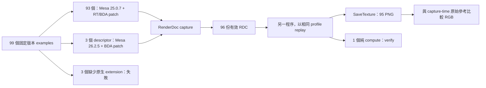

# Vulkan examples → RenderDoc capture → Lavapipe replay → PNG

本文件記錄 2026-10-19 在此雲端工作區完成的流程、實際軟體版本、四份 patch、驗證方法與結果。
功能實作基準為 [`f50a9ce`](https://github.com/cclwylin/Capture/commit/f50a9cee40f5f3ab19f3c69633608ee7a7a2d111)。

## 1. 已驗證結果

| 項目 | 結果 |
| --- | ---: |
| 固定版本的 example 資料夾 | 99 |
| 成功 capture 並以獨立程序 replay | 96 |
| 由 replay 的最終 texture 匯出 PNG | 95 |
| PNG 與原始參考 RGB 逐像素一致 | 95 / 95 |
| 純 compute，沒有影像 | 1：`computeheadless` |
| 建立 Vulkan device 時因缺少 extension 失敗 | 3 |
| Ray tracing pipeline 範例 | 9 / 9 通過 |
| Ray query 範例 | `rayquery` 通過 |
| 新補上的 descriptor 範例 | 3 / 3 通過 |

94 張視窗型 PNG 為 **640×360**；`renderheadless` 為 **1024×1024**。
每個成功範例保存一份 RDC；視窗型 RDC 包含一個完整 frame。
兩個 headless 範例以明確的工作負載 capture 邊界記錄，`computeheadless` 用 dispatch 驗證，沒有 PNG。
影像比較只比較 **RGB**，不宣稱 alpha 逐像素一致。

- [99 個範例的結果、capture/replay log](../results/report.md)
- [95 張 replay PNG 索引](../results/gallery.md)
- [每份 RDC / PNG / 參考的 SHA-256、大小與工作區路徑](../results/artifacts.json)
- [Release 實際發佈狀態與下載位置](../results/release.json)

`.rdc`、PNG、原始參考影像以 **GitHub Release assets** 提供；`main` 保存文字文件、patch、版本清單、manifest 與 log。
`release.json` 的 `prepared` 表示檔案已備妥，`draft` 表示已建立 Release 草稿；兩者都尚未發佈。
只有 `published` 才代表 Release 與下載連結已確認可用。

## 2. 使用哪些版本

### 原始碼基準

| 元件 | 版本 / 用途 | 固定 commit |
| --- | --- | --- |
| Mesa Profile A | **25.0.7**；原先成功的 93 個範例，包含全部 RT / ray query | `742a20f48c59e8649533c84c4d49dd95b403f5da` |
| Mesa Profile B | **26.2.5**；新增的三個 descriptor 範例 | `ddaf85e353442d9d7f192fdcf1823e652e3f2ee3` |
| RenderDoc | **1.47**；development source，CMake Release build，加上本 repository 的兩份 patch | `45e91661ee457e64279ff86265abdbe214aa6be0` |
| Sascha Willems Vulkan examples | 固定 Git snapshot | `1cbc8d87b731b438f47dea00a2e083ba7d59051d` |
| Vulkan-Assets submodule | 固定 Git snapshot | `a27c0e584434d59b7c7a714e9180eefca6f0ec4b` |
| GLM submodule | **0.9.9.0**，依此 checkout 的版本巨集 | `1ad55c5016339b83b7eec98c31007e0aee57d2bf` |

Mesa 26.2.5 是這次實際編譯及原生測試的較新版本。另曾查閱 **27.0.0-devel** 的
`9641b464e3c94737bbd5f5134e5150afc31c9799` 原始碼；**沒有編譯或執行這個 main 版本**。
本成果使用上述兩套 Mesa，沒有聲稱將全部 96 份 RDC 都升級到 Mesa 26 或 27 replay。

### 執行與建置工具

| 項目 | 實際觀察版本 |
| --- | --- |
| OS / architecture | Debian GNU/Linux 13.6 (trixie)，x86_64 |
| GCC / G++ | 14.2.0 |
| glibc | 2.41 |
| LLVM shared library / llvm-config | 19.1.7 |
| CMake | 3.31.6 |
| Ninja | 1.12.1 |
| Meson | 1.12.1 |
| Python | 3.12.14 |
| Mako / PyYAML / packaging | 1.4.3 / 6.0.3 / 26.3 |
| Pillow | 12.3.0；用於讀取與比較 RGB |
| pkg-config / Bison / Flex | 1.8.1 / 3.8.2 / 2.6.4 |
| glslangValidator 自報版本 | 15.2.0 |
| glslc / shaderc | 2025.2-1 |
| GitHub CLI（Release 使用） | 2.46.0 |
| Xvfb 的 Debian package | `2:21.1.16-1.3+deb13u4` |
| Vulkan loader | `libvulkan.so.1.4.309`，instance API 1.4.309 |
| Vulkan headers：RenderDoc / examples / sysroot | 1.4.356 / 1.4.355 / 1.4.309 |
| Profile A / B 的 device API | 1.4.305 / 1.4.354 |

執行檔自報版本、Debian package version、Vulkan API 與 headers 版本分別記錄。
例如快取中的 `glslang-tools` package version 是 `15.1.0+1.4.309.0-1`，而執行檔自報 15.2.0。
可使用保存的執行檔 hash 與 package hash 精確識別，無須把兩者視為同一種版本號。

- [完整版本、執行檔 hash、CMake / Meson options、runtime driver 資訊](../results/software-versions.json)
- [57 份快取 Debian 依賴套件的版本、檔名與 SHA-256](../results/package-provenance.json)

套件清單是建置依賴快取的來源紀錄，並非整個 OS 的完整 SBOM。
`vulkaninfo` 顯示的 `deviceName = llvmpipe (LLVM 19.1.7, 256 bits)` 是這套 CPU renderer 的名稱；
Vulkan ICD 由 `VK_DRIVER_FILES` 明確選用 Lavapipe。

## 3. 工作區與兩套 driver profile

| 路徑 | 用途 |
| --- | --- |
| `/workspace/Capture` | 本 repository：文件、patch、helper、驗證程式與文字結果 |
| `/workspace/renderdoc` / `renderdoc-build` | 修補版 RenderDoc 原始碼 / 編譯結果 |
| `/workspace/mesa-graphics` / `mesa-build` | Mesa 25.0.7 Profile A |
| `/workspace/mesa-26.2.5` / `mesa-26.2.5-build` | Mesa 26.2.5 Profile B |
| `/workspace/vulkan` | 固定版本 examples 與 submodules |
| `/workspace/vulkan-xcb-build` | 視窗型 examples 的 XCB build |
| `/workspace/vulkan-build` | headless base library build |
| `/workspace/headless-capture-build` | 產生的兩個 headless capture 程式 |
| `/workspace/sysroot` | 解出的 Debian headers、libraries、建置工具 |
| `/workspace/mesa-python` | Meson 等 Python 建置依賴 |
| `/workspace/verified-batch` | 有效 RDC、replay PNG、原始參考、log 與完整結果 |
| `/workspace/lavapipe-26.2.5-native/libvulkan_lvp.so` | 先前原生測試時保存的未修補 Mesa 26.2.5 driver |

`/workspace/mesa` 是先前取得的同名 Python 專案，不參與這個 graphics workflow。
早期 `/workspace/captures` 內有 initialization-only capture，保留為負面測試，不列入成功數。

| 設定 | Profile A | Profile B |
| --- | --- | --- |
| 載入 shell 設定 | `source ./env.sh` | `source ./descriptor-env.sh` |
| ICD JSON | `/workspace/lavapipe-capture-replay.json` | `/workspace/Capture/lavapipe-descriptor-replay.json` |
| driver `.so` | `/workspace/mesa-build/src/gallium/targets/lavapipe/libvulkan_lvp.so` | `/workspace/mesa-26.2.5-build/src/gallium/targets/lavapipe/libvulkan_lvp.so` |
| `LVP_CAPTURE_REPLAY` | `1` | `1` |
| `RDOC_LVP_DESCRIPTOR_REPLAY` | 不設定 | `1` |
| 用途 | 原先 93 個成功範例，包含 RT / query | descriptorbuffer / descriptorheap / descriptorheapuntyped |

`run_batch.py` 自動選擇 profile，capture 和 replay 都使用相同一套 driver。
共同設定為 `DISPLAY=:99`、`LP_NUM_THREADS=2`，動態 library 路徑包含 RenderDoc build 與 sysroot。
capture layer / preload 只加入 capture 子程序；replay 子程序不帶這些注入設定。



## 4. 四份 patch 分別修什麼

| Patch | 套用來源 | 行為 |
| --- | --- | --- |
| [lavapipe-capture-replay.patch](../patches/lavapipe-capture-replay.patch) | Mesa 25.0.7 | 實作 opt-in BDA、AS address 與 RT shader-group handle capture/replay |
| [renderdoc-replay-export-png.patch](../patches/renderdoc-replay-export-png.patch) | RenderDoc 固定 commit | 新增 replay `--export-png` / `--verify`，執行至最後事件、拒絕無 draw/dispatch 的 capture |
| [lavapipe-26.2.5-bda-capture-replay.patch](../patches/lavapipe-26.2.5-bda-capture-replay.patch) | Mesa 26.2.5 | 將 opt-in BDA 位址還原移植到新版 memory object |
| [renderdoc-lavapipe-descriptors.patch](../patches/renderdoc-lavapipe-descriptors.patch) | 同一個 RenderDoc checkout | Descriptor 重新產生、heap 命令與 shader mapping / untyped feature 的記錄及 replay |

### Mesa 25.0.7：實作位址與 RT handle 還原

Lavapipe 原本已有 ray tracing 功能；capture/replay 還需要額外的還原能力。
這份 patch 在 `LVP_CAPTURE_REPLAY=1` 時提供：

- BDA memory 使用固定的 64-bit CPU virtual address；新程序以 `mmap(MAP_FIXED_NOREPLACE)` 還原。
- 若位址已占用，回報 `VK_ERROR_INVALID_OPAQUE_CAPTURE_ADDRESS`，不覆寫現有 mapping。
- `vkGetDeviceMemoryOpaqueCaptureAddress` 回傳可還原的 memory address；buffer binding offset 被保留。
- AS 的 backing memory 還原後，AS address 也被保留，並使用現有建立 AS 的位址檢查。
- RT shader-group opaque handle 保存版本與 group ID，在編譯前還原；調整 ID allocator，避免新 group 碰撞。
- 無效 opaque handle 被拒絕；未設定 opt-in 時不公開這些 capture/replay feature。

### RenderDoc：真正 replay 後匯出 PNG

`renderdoccmd replay --export-png` 載入 RDC、確認存在 GPU work、執行至最後事件，
選擇最終 presented image / colour attachment，再透過 `IReplayController::SaveTexture` 匯出。
`--verify` 用於沒有 colour image 的 compute capture。
載入失敗、無 draw/dispatch、fatal replay error、texture 匯出失敗都不能視為成功；timeout 也不算成功。

capture-time lossless thumbnail 只當作**原始參考**。交付的 replay PNG 由 replay texture 另行讀回，
沒有把 thumbnail 當成 replay 輸出。

### 三個 descriptor 範例：重新產生 process-local descriptor

Mesa 26.2.5 原生可執行這三個範例，但 descriptor bytes 內含本程序的 CPU/JIT 指標，
不能直接拿到另一程序使用。實驗路徑會保存 descriptor 說明與原始 bytes，在 replay 中重新產生 native bytes，
並只替換已綁定 descriptor buffer / heap 範圍內匹配的資料。
新增的 heap descriptor writes、heap binds、push data、shader set/binding mappings 與 untyped feature 會被記錄及重播。
範例的 shader 及 native heap 繪圖命令仍照原本流程執行。

這個做法沒有把 Mesa 的 `descriptorBufferCaptureReplay` 或 `descriptorHeapCaptureReplay` 改成 true。
Profile B 只移植 BDA；它的 AS / RT shader-group capture/replay feature 仍為 false。
因此原先的 RT captures 使用 Profile A。Heap replay 若未啟用 `RDOC_LVP_DESCRIPTOR_REPLAY=1`，會明確拒絕。

## 5. 如何取得來源與套用 patch

已準備好的雲端 snapshot 直接執行第 6 節。以下是為新 checkout 記錄的來源與手動 patch 流程；
本次驗證的是現有 snapshot 的編譯與執行，沒有宣稱在全新 OS 完成無依賴的 bootstrap。

```sh
cd /workspace
git clone https://github.com/cclwylin/Capture.git Capture
git clone --no-checkout https://github.com/baldurk/renderdoc.git renderdoc
git -C renderdoc checkout --detach 45e91661ee457e64279ff86265abdbe214aa6be0
git clone --no-checkout https://github.com/chaotic-cx/mesa-mirror.git mesa-graphics
git -C mesa-graphics checkout --detach 742a20f48c59e8649533c84c4d49dd95b403f5da
git clone --no-checkout https://github.com/chaotic-cx/mesa-mirror.git mesa-26.2.5
git -C mesa-26.2.5 checkout --detach ddaf85e353442d9d7f192fdcf1823e652e3f2ee3
git clone --no-checkout https://github.com/SaschaWillems/Vulkan.git vulkan
git -C vulkan checkout --detach 1cbc8d87b731b438f47dea00a2e083ba7d59051d
git -C vulkan submodule update --init --recursive
```

Mesa 官方專案為 freedesktop Mesa；這次在雲端使用 GitHub mirror 取得對應 commit。
Assets 與 GLM 的 gitlink 已固定在上述 examples commit。

在**尚未套用 patch**、且版本正確的 checkout：

```sh
git -C /workspace/mesa-graphics apply --check /workspace/Capture/patches/lavapipe-capture-replay.patch
git -C /workspace/mesa-graphics apply /workspace/Capture/patches/lavapipe-capture-replay.patch
git -C /workspace/mesa-26.2.5 apply --check /workspace/Capture/patches/lavapipe-26.2.5-bda-capture-replay.patch
git -C /workspace/mesa-26.2.5 apply /workspace/Capture/patches/lavapipe-26.2.5-bda-capture-replay.patch
git -C /workspace/renderdoc apply --check /workspace/Capture/patches/renderdoc-replay-export-png.patch
git -C /workspace/renderdoc apply /workspace/Capture/patches/renderdoc-replay-export-png.patch
git -C /workspace/renderdoc apply --check /workspace/Capture/patches/renderdoc-lavapipe-descriptors.patch
git -C /workspace/renderdoc apply /workspace/Capture/patches/renderdoc-lavapipe-descriptors.patch
```

平常使用 `./rebuild.sh` 即可：它會檢查固定 HEAD，以 `git apply --reverse --check` 辨認已套用的 patch，
不重複套用，也不執行 `git reset`。人工檢查已套用狀態可使用：

```sh
git -C /workspace/mesa-graphics apply --reverse --check /workspace/Capture/patches/lavapipe-capture-replay.patch
git -C /workspace/mesa-26.2.5 apply --reverse --check /workspace/Capture/patches/lavapipe-26.2.5-bda-capture-replay.patch
git -C /workspace/renderdoc apply --reverse --check /workspace/Capture/patches/renderdoc-replay-export-png.patch
git -C /workspace/renderdoc apply --reverse --check /workspace/Capture/patches/renderdoc-lavapipe-descriptors.patch
```

## 6. 建置與啟動

### 依賴與初始 CMake 配置

此 snapshot 已保留 sysroot 與 Python 依賴。主要依賴是 GCC/G++、CMake、Ninja、Meson、LLVM 19 dev / shared library、
libdrm、X11/XCB dev、Bison/Flex、zlib、libelf、glslang-tools、Vulkan loader/headers、Xvfb、Mako、PyYAML 與 Pillow。
完整版本見版本清單。現有 `.spv` 來自固定 examples checkout；沒有用這裡的 glslangValidator 重編全部範例 shader。

若已備妥相同 sysroot，首次 CMake 配置對應本次 build 的設定如下：

```sh
cd /workspace/Capture
source ./env.sh
export PKG_CONFIG_SYSROOT_DIR=/workspace/sysroot
export PKG_CONFIG_PATH=/workspace/sysroot/usr/lib/x86_64-linux-gnu/pkgconfig:/workspace/sysroot/usr/share/pkgconfig
cmake -S /workspace/renderdoc -B /workspace/renderdoc-build -G Ninja \
  -DCMAKE_BUILD_TYPE=Release -DENABLE_VULKAN=ON -DENABLE_RENDERDOCCMD=ON \
  -DENABLE_QRENDERDOC=OFF -DENABLE_PYRENDERDOC=OFF -DENABLE_GL=OFF -DENABLE_GLES=OFF \
  -DENABLE_XCB=ON -DENABLE_XLIB=ON \
  -DCMAKE_CXX_FLAGS=-I/workspace/sysroot/usr/include \
  -DCMAKE_EXE_LINKER_FLAGS=-L/workspace/sysroot/usr/lib/x86_64-linux-gnu
cmake -S /workspace/vulkan -B /workspace/vulkan-xcb-build -G Ninja \
  -DCMAKE_BUILD_TYPE=Release -DUSE_HEADLESS=OFF -DUSE_WAYLAND_WSI=OFF \
  -DCMAKE_CXX_COMPILER=/usr/bin/g++ -DCMAKE_CXX_FLAGS=-I/workspace/sysroot/usr/include \
  -DVulkan_INCLUDE_DIR=/workspace/sysroot/usr/include \
  -DVulkan_LIBRARY=/usr/lib/x86_64-linux-gnu/libvulkan.so.1
cmake -S /workspace/vulkan -B /workspace/vulkan-build -G Ninja \
  -DCMAKE_BUILD_TYPE=Release -DUSE_HEADLESS=ON -DUSE_WAYLAND_WSI=OFF \
  -DCMAKE_CXX_COMPILER=/usr/bin/g++ -DVulkan_INCLUDE_DIR=/workspace/sysroot/usr/include \
  -DVulkan_LIBRARY=/usr/lib/x86_64-linux-gnu/libvulkan.so.1
```

RenderDoc 只編譯 Vulkan CLI；Qt UI、Python replay binding 與 OpenGL API 未啟用。
兩套 Mesa 的完整 Meson setup 指令在 [rebuild.sh](../rebuild.sh)，主要參數為：
`release`、`gallium-drivers=llvmpipe`、`vulkan-drivers=swrast`、`platforms=x11`、shared LLVM 19，
不建置 OpenGL/GLES/EGL/GLX、video codecs、Mesa build-tests。
兩版本的 option 差異已處理，例如 `gallium-vdpau=disabled` 只傳給 Mesa 25。
這裡的結果來自 integration checks，沒有宣稱已跑 Mesa unit tests 或 Vulkan CTS。

設定檔範本也已保存：

```sh
cp /workspace/Capture/configs/lavapipe-capture-replay.json /workspace/lavapipe-capture-replay.json
cp /workspace/Capture/configs/renderdoc_capture_local.json /workspace/renderdoc_capture_local.json
```

### 已準備 snapshot 的驗證過步驟

```sh
cd /workspace/Capture
./rebuild.sh
./start.sh
```

`rebuild.sh` 建置兩個 Lavapipe、RenderDoc CLI、XCB examples、headless base library、capture hook 與 probes。
`build_headless.py` 對產生的副本加上 capture API 呼叫；upstream examples 的 tracked source 保持原樣。
`start.sh` 在必要時啟動 Xvfb `:99`（1280×720×24），確認 X11 連線，再執行 triangle benchmark。
snapshot 還原後需重新啟動服務；不能只依賴先前的 Xvfb PID。

## 7. Capture、replay、匯出與 RGB 比較

```sh
cd /workspace/Capture
python3 run_batch.py --refresh
python3 report.py
python3 tools/publish_results.py
```

這組範例預期仍有三個缺 extension；成功數由 `results.json` 與 `report.py` 的實際狀態檢查判定。
`run_batch.py` 的整批 process exit code 本身不能當作「99 個全過」的證據。
`report.py` 會要求目前固定集合為 95 PNG + 1 compute + 3 已知 capture failures。

批次 capture 使用 `VK_LAYER_RENDERDOC_Capture`、`VK_LAYER_PATH=/workspace`，
視窗型加上 `LD_PRELOAD=/workspace/libframe_capture_hook.so`。
hook 在 presentation 邊界要求下一個完整 frame，避免只有 initialization submits 的 RDC。
一般視窗範例於 frame 1 capture；`computecullandlod` 等 buffered UBO 初始化後在 frame 4 capture。
程式雖可跑數個 benchmark frames，每個 RDC 仍只有一個 capture frame。

每個範例的 capture 與 replay 都是不同的 subprocess。每次執行上限 120 秒；timeout 記為失敗。
程式檢查 RDC 是否為本次產生、replay 是否正常結束、PNG 是否可讀，再逐像素比較 RGB。
視窗型原始參考來自 `Capture.IncludeExtendedThumbnail` 的 lossless PNG；
`renderheadless` 的原始參考是 native `headless.ppm`。

單獨操作 RT / ray query capture：

```sh
cd /workspace/Capture
source ./env.sh
renderdoccmd replay --export-png /workspace/raytracing-reflections.png \
  /workspace/verified-batch/captures/raytracingreflections_frame1.rdc
renderdoccmd replay --verify /workspace/verified-batch/captures/computeheadless_capture.rdc
```

只補抓三個 descriptor 範例，或單獨 replay：

```sh
cd /workspace/Capture
python3 run_batch.py --refresh descriptorbuffer descriptorheap descriptorheapuntyped
source ./descriptor-env.sh
renderdoccmd replay --export-png /workspace/descriptorheap.png \
  /workspace/verified-batch/captures/descriptorheap_frame1.rdc
```

## 8. 驗證與問題歸屬

```sh
cd /workspace/Capture
./verify.sh
./verify_descriptors.sh
python3 report.py
python3 tools/publish_results.py
```

| 檢查 | 證據 |
| --- | --- |
| 獨立程序 memory / buffer / AS 位址還原、非零 binding offset、occupied address 不覆寫 | [RT / BDA regression log](../results/evidence/regression-raytracing.log) |
| Shader-group handle 在不同建立順序還原、新 ID 不碰撞、錯誤 handle 被拒絕 | [同一份 regression log](../results/evidence/regression-raytracing.log) |
| 九個 RT pipeline + rayquery 的 replay 及 RGB 比較 | [同一份 regression log](../results/evidence/regression-raytracing.log) |
| 新版 BDA、三個 descriptor replay / RGB 比較 | [descriptor verification log](../results/evidence/descriptor-verification.log) |
| 未開 driver opt-in | [disabled log](../results/evidence/bda-disabled.log) |
| 未開 descriptor regeneration | [拒絕 replay 的 log](../results/evidence/descriptor-mode-disabled.log) |
| Initialization-only capture 不被當成有效繪圖 | [拒絕 log](../results/evidence/initialization-rejection.log) |
| 重複 rebuild | [repeat log](../results/evidence/rebuild-repeat.log) |
| 實際載入的兩套 driver 與 features | [Profile A](../results/evidence/profile-A-vulkaninfo.txt) / [Profile B](../results/evidence/profile-B-vulkaninfo.txt) |

最初六個失敗項目，後續使用未修補 Mesa 26.2.5 做過原生測試：

| 範例 | Mesa 26.2.5 原生執行 | 最終 capture/replay |
| --- | --- | --- |
| `descriptorbuffer` | exit 0，2408 frames / 3 秒 | 已補齊，RGB 一致 |
| `descriptorheap` | exit 0，4137 frames / 3 秒 | 已補齊，RGB 一致 |
| `descriptorheapuntyped` | exit 0，3801 frames / 3 秒 | 已補齊，RGB 一致 |
| `conservativeraster` | 缺 `VK_EXT_conservative_rasterization`，0 frames | 仍受原生 driver 能力限制 |
| `fragmentshaderbarycentrics` | 缺 `VK_KHR_fragment_shader_barycentric`，0 frames | 同上 |
| `variablerateshading` | 缺 `VK_KHR_fragment_shading_rate`，0 frames | 同上 |

這次原生測試沒有載入 RenderDoc；成功程序觀察到新版 driver 已載入。
失敗三項回報 `ERROR_EXTENSION_NOT_PRESENT`，不是 ray tracing 功能。
上面的 frames 是短 benchmark 結果，不是效能比較結論，也不是 capture 數量。
原始記錄：[native results](../results/native-mesa-26.2.5/results.json) / [native logs](../results/native-mesa-26.2.5/logs)。
這是較早的未修補測試紀錄；其 log 中的 build 路徑後來用來編譯 opt-in patch，未修補 `.so` 另行保存。

Mesa 自己的 [功能表（barycentric / VRS）](https://github.com/chaotic-cx/mesa-mirror/blob/ddaf85e353442d9d7f192fdcf1823e652e3f2ee3/docs/features.txt#L559)
及 [conservative rasterization](https://github.com/chaotic-cx/mesa-mirror/blob/ddaf85e353442d9d7f192fdcf1823e652e3f2ee3/docs/features.txt#L618)
列出了其他已完成驅動，未列 `lvp`；Lavapipe extension 清單與原生執行錯誤也一致。
這支持「Lavapipe 在此版本未提供這三項支援」，沒有把它解讀為 Mesa 全部 driver 都沒做，或未來不會做。

## 9. GitHub main 與 Release

`main` 保存完整文件、四份 patch、helper/probe、軟體版本、package provenance、99 個結果與文字 log。
二進位 `.rdc` / PNG / PPM 原始參考放在 Release，避免將它們累積進 Git history。
可由 [release.json](../results/release.json) 確認實際狀態；每個檔案的 hash 保存在 manifest。

預備 tag：`vulkan-lavapipe-2026-10-19`。
Release 說明已準備於 [RELEASE_NOTES.zh-TW.md](RELEASE_NOTES.zh-TW.md)。
上傳需要 `api.github.com` 與 `uploads.github.com` 能連線；Git push 成功本身不代表 Release API 可用。

本次環境曾有兩個不同的阻礙：網路 proxy 對 API 回覆 CONNECT 403，加入上述網域後已能建立 draft；
接著 asset upload 回覆 HTTP 401 `Bad credentials`，尚未上傳任何附件。
API 成功不保證上傳端取得有效憑證。已保存 `GITHUB_RELEASE_TOKEN` Secret 要求草稿，
將它對應到 `GH_TOKEN`，限定送往 `api.github.com`、`uploads.github.com`。
需要由使用者在環境 Secrets 填入限定 `cclwylin/Capture`、具有 **Contents: Read and write** 的 fine-grained PAT，
儲存並發布環境後重測。Secret 值不放在聊天、Git、指令文字或 log 中。
實際發佈狀態以 [release.json](../results/release.json) 為準，已存在的 draft 應接續上傳，避免重建。

發佈順序為：完成並驗證檔案 → push 文件到 `main` → 建立 draft Release → 上傳並檢查所有 assets → 發佈 Release。
使用現有 GitHub 認證，不將 token 寫進文件或 log。

```sh
cd /workspace/Capture
release_tag=vulkan-lavapipe-2026-10-19
release_commit=$(git rev-parse HEAD)
gh release create "$release_tag" --repo cclwylin/Capture --target "$release_commit" \
  --draft --title 'Lavapipe Vulkan capture/replay: 96 captures, 95 verified PNGs' \
  --notes-file docs/RELEASE_NOTES.zh-TW.md
gh release upload "$release_tag" --repo cclwylin/Capture \
  /workspace/vulkan_verified_captures.tar.gz /workspace/vulkan_verified_pngs.zip \
  /workspace/vulkan_verified_references.zip /workspace/vulkan_descriptor_captures.zip \
  /workspace/lavapipe_renderdoc_fix.tar.gz /workspace/vulkan_native_verification.zip \
  /workspace/SHA256SUMS
gh release upload "$release_tag" --repo cclwylin/Capture /workspace/verified-batch/png/*.png
gh release view "$release_tag" --repo cclwylin/Capture --json assets
# 檢查 asset 名稱、大小、hash 完成後才執行：
gh release edit "$release_tag" --repo cclwylin/Capture --draft=false
```

目前 RDC 集合約 1.40 GB，單一 archive 小於 GitHub 的 2 GiB asset 限制。
下載 Release 檔案後可用 `sha256sum --check --ignore-missing SHA256SUMS` 驗證已下載的項目。
要重新 replay，需取得 RDC archive，使用同一份修補版與正確 profile；stock RenderDoc / Mesa 不等同這個實驗組合。

例如將下載檔放在 `/workspace`，可還原 batch 的資料目錄：

```sh
mkdir -p /workspace/verified-batch/png
tar -xzf /workspace/vulkan_verified_captures.tar.gz -C /workspace/verified-batch
unzip /workspace/vulkan_verified_pngs.zip -d /workspace/verified-batch/png
unzip /workspace/vulkan_verified_references.zip -d /workspace/verified-batch
```

## 10. 已知限制

- Linux 64-bit opt-in 實作，未宣稱通過完整 Vulkan CTS、上游已接受，或可跨 driver / OS replay。
- Mesa 25 的 RT mixed captured/uncaptured shader handles 與 external-memory 組合未涵蓋。
- Descriptor 驗證範圍是這三個範例的 CPU-written descriptor storage 與完整 frame replay / PNG export。
  GPU 產生或轉換的 descriptors、任意動態更新、partial replay state restoration、heap inspection、shader debugging 與其他 driver 未涵蓋。
- 尚餘三個 native extension 缺口，沒有有效 RDC，不能列為成功。
- 此 repository 的重建腳本針對保留 sources / sysroot / build tools 的 snapshot；全新 OS bootstrap 尚未獨立驗證。
- GitHub push、Release 發佈、雲端環境設定儲存與 snapshot 發布是不同操作，不能互相當作已完成的證據。
